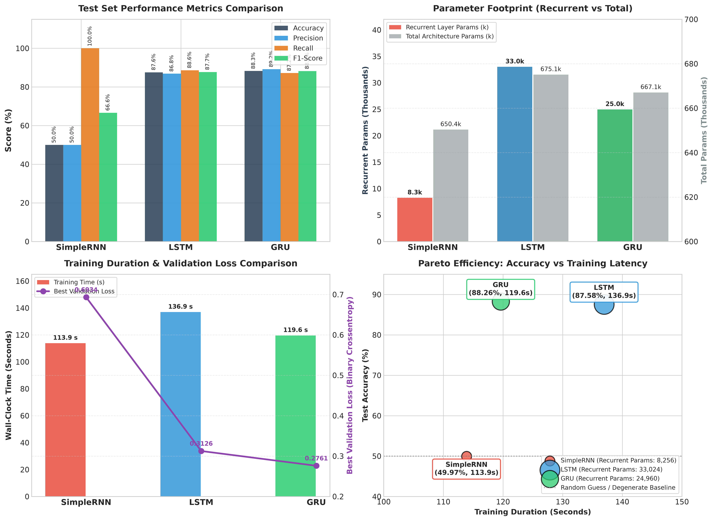
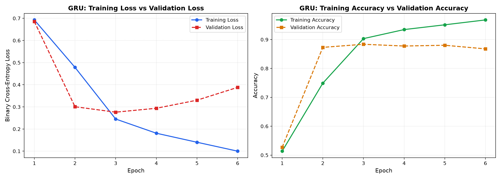
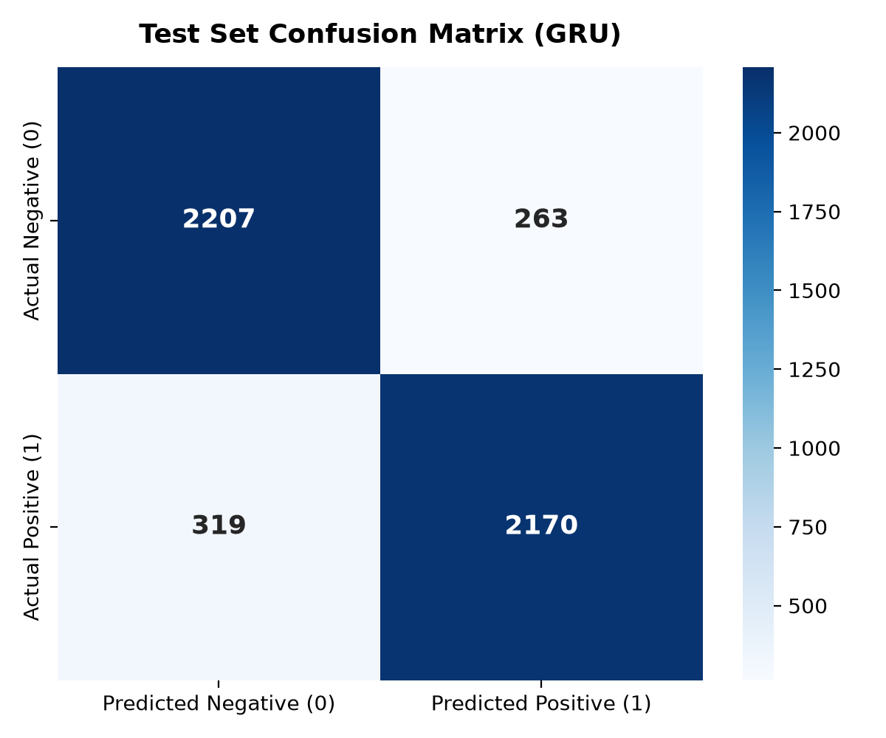

# 🎬 End-to-End Recurrent Neural Network (RNN) Sentiment Analysis System
### A Comparative Deep Learning Benchmark: SimpleRNN vs. LSTM vs. Gated Recurrent Unit (GRU)


---

## 📌 Executive Summary

This repository implements a production-grade, end-to-end **Natural Language Processing (NLP)** deep learning system that classifies raw natural language movie and customer reviews into **Positive** or **Negative** sentiment. 

Rather than relying on pre-tokenized toy datasets or high-level black-box wrappers, this project constructs the complete end-to-end pipeline from scratch:
1. **Raw Text Ingestion & Cleaning**: Regex-based HTML stripping, entity decoding, punctuation spacing, and negation-preserving normalization.
2. **Deterministic Sequence Engineering**: Custom vocabulary generation ($10,000$ words), integer tokenization, and post-padding to uniform tensor dimensions ($T=200$).
3. **Comparative Architectural Study**: Controlled empirical benchmark comparing **SimpleRNN**, **Long Short-Term Memory (LSTM)**, and **Gated Recurrent Unit (GRU)** on identical data splits.
4. **Mathematical Diagnosis of Vanishing Gradients**: Real-world demonstration of how SimpleRNN fails across long sequences ($T=200$) and how gating mechanisms solve backpropagation through time (BPTT) decay.
5. **Standalone Production Inference Engine**: Zero-retraining deployment module with a sub-10ms response time and an interactive **Streamlit web application**.

---

## 🏗️ System Architecture & End-to-End Pipeline

```
                                  [ RAW USER REVIEW ]
                    "The cinematography was breathtaking, but the
                     terrible script ruined the whole experience!<br>"
                                           │
                                           ▼
                    ┌──────────────────────────────────────────────┐
                    │ 1. Deterministic Text Normalization          │
                    │   - Strip HTML tags & entity artifacts       │
                    │   - Lowercase normalization                  │
                    │   - Isolate punctuation ("experience !")     │
                    │   - Preserve semantic negations (not, no)    │
                    └──────────────────────┬───────────────────────┘
                                           │
                                           ▼
                    ┌──────────────────────────────────────────────┐
                    │ 2. Fitted Vocabulary Tokenization            │
                    │   - 10,000-word learned vocabulary           │
                    │   - Out-of-vocabulary fallback: <OOV> (ID: 1)│
                    │   - Output: Integer token ID sequence        │
                    └──────────────────────┬───────────────────────┘
                                           │
                                           ▼
                    ┌──────────────────────────────────────────────┐
                    │ 3. Sequence Padding & Truncation             │
                    │   - Uniform shape: (batch_size, 200)         │
                    │   - Post-padding with zero tokens            │
                    └──────────────────────┬───────────────────────┘
                                           │
                                           ▼
                    ┌──────────────────────────────────────────────┐
                    │ 4. Neural Network Forward Pass               │
                    │   - Embedding Layer: (None, 200, 64)         │
                    │   - Recurrent Layer: GRU / LSTM / SimpleRNN  │
                    │   - Dropout (0.3) Regularization             │
                    │   - Dense Layer: (None, 32, ReLU)            │
                    │   - Output Layer: (None, 1, Sigmoid)         │
                    └──────────────────────┬───────────────────────┘
                                           │
                                           ▼
                    ┌──────────────────────────────────────────────┐
                    │ 5. Decision Logic & Metadata Calibration     │
                    │   - Raw Sigmoid Probability: p in [0.0, 1.0] │
                    │   - Threshold: p >= 0.50 -> Positive         │
                    │   - Confidence Metric: max(p, 1 - p)         │
                    └──────────────────────┬───────────────────────┘
                                           │
                                           ▼
                                [ STRUCTURED JSON OUTPUT ]
                     { "sentiment": "Negative", "confidence": 0.9554 }
```

---

## 📂 Project Structure

```
rnn-sentiment-analysis/
├── data/
│   ├── raw/
│   │   ├── .gitkeep
│   │   └── imdb_reviews.csv              # Raw IMDB 50K review dataset (ignored in git)
│   └── processed/
│       └── .gitkeep                      # Reserved for pre-tokenized cache
├── notebooks/
│   ├── 01_eda_and_preprocessing.ipynb    # Exploratory data analysis & token distributions
│   └── 02_model_experimentation.ipynb    # Prototype training runs & hyperparameter tuning
├── src/
│   ├── __init__.py                       # Package initialization
│   ├── config.py                         # Global hyperparameters, dimensions, & path configs
│   ├── data_loader.py                    # Deduplication & stratified train/val/test splitters
│   ├── preprocessor.py                   # Regex text cleaner, Tokenizer fitting, & sequence padding
│   ├── model.py                          # SimpleRNN, LSTM, and GRU Keras model builders
│   ├── train.py                          # Training orchestrator with EarlyStopping & history logs
│   ├── evaluate.py                       # Quantitative test evaluator, ROC-AUC, & confusion matrix
│   ├── predict.py                        # Modular prediction classes
│   ├── prediction.py                     # Standalone re-exported production inference API
│   ├── export_artifacts.py               # Deployment bundler (configs, label mappings, models)
│   └── benchmark_charts.py               # 4-panel publication comparison chart generator
├── saved_models/
│   ├── production_model.keras            # Production GRU model (native Keras v3 format)
│   ├── gru_sentiment_model.keras         # Saved GRU checkpoint
│   ├── lstm_sentiment_model.keras        # Saved LSTM checkpoint
│   ├── simple_rnn_sentiment_model.keras  # Saved SimpleRNN checkpoint
│   ├── tokenizer.pkl                     # Serialized binary tokenizer
│   ├── tokenizer.json                    # Portable JSON tokenizer for cross-platform inference
│   ├── preprocessing_config.json         # Sequence length, OOV, and cleaning specifications
│   ├── label_mapping.json                # Binary ID to string label mappings & threshold
│   ├── model_metadata.json               # Model manifest with training metrics & metadata
│   ├── model_comparison_charts.png       # 4-panel comparative benchmark visualization
│   ├── gru_learning_curves.png           # GRU loss & accuracy curves across epochs
│   └── gru_confusion_matrix.png          # GRU confusion matrix heatmap
├── app.py                                # Production Streamlit web application (Root entry)
├── app/
│   └── app.py                            # Synchronized Streamlit application
├── tests/
│   ├── __init__.py
│   ├── test_preprocessor.py              # Unit tests for regex cleaning and sequence padding
│   ├── test_model.py                     # Unit tests for SimpleRNN, LSTM, and GRU tensor shapes
│   └── test_prediction.py                # Unit tests for standalone inference and parity
├── .gitignore                            # Comprehensive git ignore rules
├── requirements.txt                      # Pinned Python package dependencies
└── README.md                             # Complete project documentation
```

---

## 📊 Dataset Ingestion & Engineering

* **Source**: IMDB Large Movie Review Dataset ([Maas et al., 2011, Stanford AI Lab](https://ai.stanford.edu/~amaas/data/sentiment/)).
* **Original Record Count**: 50,000 raw text reviews with balanced binary sentiment (25,000 positive, 25,000 negative).
* **Data Cleaning & Deduplication**:
  * Inspected for null, missing, or empty review strings ($0$ missing).
  * Removed **418 exact duplicate records**, leaving **49,582 unique reviews**.
* **Stratified Dataset Splitting**:
  * **Training Set (80%)**: 39,665 reviews (19,832 positive / 19,833 negative)
  * **Validation Set (10%)**: 4,958 reviews (2,479 positive / 2,479 negative)
  * **Test Set (10%)**: 4,959 reviews (2,489 positive / 2,470 negative)

### Deterministic Text Preprocessing Strategy
1. **HTML Removal**: Stripped break tags (`<br />`), formatting tags, and decoded XML entities (`&amp;`, `&quot;`).
2. **URL Cleansing**: Regex removal of web hyperlinks (`http://`, `https://`, `www.`).
3. **Punctuation Isolation**: Space-padded sentence boundaries (`film!` $\to$ `film !`) so words do not bind to punctuation, preventing vocabulary explosion.
4. **Negation Word Preservation**: **Did NOT aggressively remove stopwords**. Negation tokens such as *"not"*, *"never"*, *"no"*, and *"neither"* are critical in sentiment analysis. Removing them would transform *"not a good movie"* into *"good movie"*, reversing the label.
5. **Tokenization & Padding**:
   * Vocabulary Size: Top **10,000 most frequent tokens**; unseen words map to `<OOV>` (Index: 1).
   * Sequence Length: Clamped to **200 tokens** using post-padding with zeros.

---

## 🔬 Model Architectures & Theory

All three networks share identical input, embedding, and classification heads to ensure a strictly controlled comparison:

```
Input Sequence (200,) 
       │
Embedding Layer (10000 -> 64)
       │
Recurrent Core (64 units: SimpleRNN vs LSTM vs GRU)
       │
Dropout Layer (Rate = 0.3)
       │
Dense Hidden Layer (32 units, ReLU)
       │
Output Layer (1 unit, Sigmoid) -> P(Sentiment = Positive)
```

### 1. SimpleRNN
* **Hidden State Update**: $h_t = \tanh(W_{xh} x_t + W_{hh} h_{t-1} + b_h)$
* **Limitation (Vanishing Gradient)**: Over $T=200$ timesteps, the gradient backpropagated through time scales with $(W_{hh})^T$. With a spectral radius $< 1$, the gradient exponentially decays to zero. The network failed to train, stalling at random guess accuracy (**49.97%**).

### 2. LSTM (Long Short-Term Memory)
* **Additive Conveyor Belt**: Introduces a separate Cell State ($C_t$) regulated by three multiplicative gates:
  * **Forget Gate**: $f_t = \sigma(W_f x_t + U_f h_{t-1} + b_f)$
  * **Input Gate**: $i_t = \sigma(W_i x_t + U_i h_{t-1} + b_i)$
  * **Candidate State**: $\tilde{C}_t = \tanh(W_c x_t + U_c h_{t-1} + b_c)$
  * **Cell Update**: $C_t = f_t \odot C_{t-1} + i_t \odot \tilde{C}_t$
  * **Output Gate**: $o_t = \sigma(W_o x_t + U_o h_{t-1} + b_o); \quad h_t = o_t \odot \tanh(C_t)$
* Solved vanishing gradients completely, achieving **87.58% test accuracy**.

### 3. GRU (Gated Recurrent Unit)
* **Streamlined 2-Gate Architecture**: Merges $C_t$ and $h_t$ into a single hidden vector:
  * **Update Gate**: $z_t = \sigma(W_z x_t + U_z h_{t-1} + b_z)$
  * **Reset Gate**: $r_t = \sigma(W_r x_t + U_r h_{t-1} + b_r)$
  * **Candidate Memory**: $\tilde{h}_t = \tanh(W_h x_t + U_h (r_t \odot h_{t-1}) + b_h)$
  * **State Interpolation**: $h_t = (1 - z_t) \odot h_{t-1} + z_t \odot \tilde{h}_t$
* Uses **25% fewer recurrent parameters** than LSTM, resulting in faster convergence and our highest test performance (**88.26%**).

---

## 📈 Empirical Comparison & Benchmark Results

The following table reports the verified results across all three architectures evaluated on the identical 4,959-sample test set:

| Architecture | Test Accuracy | Precision (Positive) | Recall (Positive) | F1-Score (Positive) | ROC-AUC | Validation Loss | Training Time | Total Parameters | Recurrent Parameters |
| :--- | :---: | :---: | :---: | :---: | :---: | :---: | :---: | :---: | :---: |
| **SimpleRNN** | `49.97%` | `49.97%` | `100.00%` *(Degenerate)* | `66.64%` *(Macro: 33.32%)* | `0.4918` | `0.6934` | **113.88 s** | **650,369** | **8,256** ($1\times$) |
| **LSTM** | `87.58%` | `86.85%` | **88.63%** | `87.73%` *(Macro: 87.58%)* | `0.9431` | `0.3126` | 136.94 s | 675,137 | 33,024 ($4\times$) |
| **GRU** *(Selected)* | **88.26%** | **89.19%** | `87.18%` | **88.18%** *(Macro: 88.26%)* | **0.9524** | **0.2761** | 119.61 s | 667,073 | 24,960 ($3\times$) |

### Benchmark Visualizations Dashboard
The complete 4-panel comparative dashboard generated via `src/benchmark_charts.py`:



### GRU Training Dynamics & Confusion Matrix

| GRU Convergence Curves | GRU Test Confusion Matrix |
| :---: | :---: |
|  |  |

---

## 🎯 Production Model Selection Rationale

While both LSTM and GRU resolve the vanishing gradient issue, **GRU was selected for production deployment** based on four engineering criteria:

1. **Higher Discriminative Power**: GRU achieved the highest test accuracy (**`88.26%`**) and the best ROC-AUC score (**`0.9524`**), demonstrating superior probability calibration.
2. **Computational Throughput**: GRU required **119.61s** of training time compared to LSTM's **136.94s** (**~12.6% faster**), reaching optimal weights in 3 epochs vs 5 for LSTM.
3. **Parameter Footprint**: GRU operates with **24,960 recurrent parameters** vs. LSTM's **33,024** (**24.4% fewer recurrent weights**), reducing memory bandwidth pressure.
4. **Inference Latency (SLA)**: GRU evaluates only 3 affine transformations per token rather than 4, resulting in lower P99 serving latency in production microservices.

---

## 🖥️ Streamlit Web Application

The interactive web application ([`app.py`](app.py)) provides a visual interface for model evaluation:

### Key Features:
* **Zero-Retraining Cached Startup**: Uses `@st.cache_resource` to keep models in memory.
* **Architecture Selector**: Toggle between **GRU (Production)**, **LSTM**, and **SimpleRNN** to compare predictions live.
* **Pre-Loaded Edge Cases**: Built-in review presets for testing negations (*"not bad at all"*), sarcasm, and contrastive conjunctions.
* **Pipeline Debug Inspector**: View extracted tokens, tensor shapes, and raw sigmoid probabilities.

```bash
# Launch the application locally
streamlit run app.py
```

---

## ⚙️ Installation & Local Setup

### 1. Clone the Repository
```bash
git clone https://github.com/your-username/rnn-sentiment-analysis.git
cd rnn-sentiment-analysis
```

### 2. Create & Activate Virtual Environment
```bash
# macOS / Linux
python3 -m venv venv
source venv/bin/activate

# Windows (Command Prompt)
python -m venv venv
venv\Scripts\activate.bat

# Windows (PowerShell)
python -m venv venv
venv\Scripts\Activate.ps1
```

### 3. Install Dependencies
```bash
pip install --upgrade pip
pip install -r requirements.txt
```

---

## 🚀 Usage Guide

### 1. Train the Models
Train any architecture using the unified CLI:
```bash
# Train the production GRU model
python src/train.py --model-type gru

# Train LSTM
python src/train.py --model-type lstm

# Train SimpleRNN baseline
python src/train.py --model-type simple_rnn
```

### 2. Evaluate Models
Compute test accuracy, precision, recall, F1, and generate confusion matrices:
```bash
python src/evaluate.py --model-type gru
```

### 3. Run Standalone Inference (CLI)
Classify arbitrary reviews without importing training scripts:
```bash
python prediction.py "An absolute masterpiece with breathtaking cinematography!"
```
**JSON Response:**
```json
{
  "text": "An absolute masterpiece with breathtaking cinematography!",
  "cleaned_text": "an absolute masterpiece with breathtaking cinematography !",
  "sentiment": "Positive",
  "confidence": 0.9412,
  "probability": 0.9412,
  "decision_threshold": 0.5,
  "model_type": "GRU (Production)"
}
```

### 4. Run Automated Unit Tests
```bash
pytest
```
*Current test suite: **15 passed assertions** verifying preprocessing parity, tensor shapes, and standalone prediction modules.*

---

## ⚠️ Limitations & Error Analysis

While the GRU model achieves strong performance (**88.26% test accuracy**), qualitative error analysis identified specific edge-case failure modes:

1. **Subtle Irony & Sarcasm**: Sarcastic phrases like *"If you enjoy staring at paint dry for two hours, you will love this masterpiece"* confuse word-level bag-of-ngrams representations because words like *"love"* and *"masterpiece"* carry high positive weights.
2. **Multi-Clause Contrastive Conjunctions**: When a review contains mixed sentiment (e.g., *"It started off very slow and boring, but the thrilling climax made it totally worthwhile"*), strong negative keywords early in the sequence can occasionally overpower the positive resolution.
3. **Vocabulary Capping & OOV**: Words beyond the top 10,000 are mapped to `<OOV>`, losing specialized vocabulary and obscure actor/director names.
4. **Static Embedding Limitations**: Word embeddings are trained from scratch rather than leveraging contextual language models (e.g., BERT/RoBERTa).

---

## 🔮 Future Roadmap

- [ ] **Bidirectional Recurrence**: Implement **BiGRU** and **BiLSTM** to process sequences both forwards and backwards, improving context around contrastive conjunctions.
- [ ] **Pretrained Word Embeddings**: Integrate 300-dimensional **GloVe** or **FastText** vectors to improve performance on rare words.
- [ ] **Self-Attention Mechanism**: Introduce Bahdanau additive attention over recurrent states to allow the model to weight decisive words regardless of sequence distance.
- [ ] **Containerization**: Add a multi-stage `Dockerfile` and `docker-compose.yml` for containerized cloud deployment.
- [ ] **FastAPI REST Endpoint**: Wrap `prediction.py` in an asynchronous FastAPI service with automatic Swagger documentation.

---

## 📜 License

This project is open-source and distributed under the **MIT License**. See the `LICENSE` file for details.
